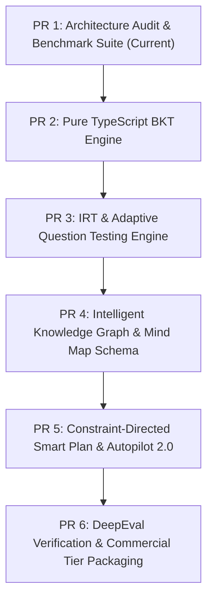

# Gradify Intelligence — Architecture Audit, Open-Source Research & Benchmark Specification

**Programme:** Gradify Intelligence Engine Improvement  
**Author:** Gradify Engineering & Cognitive Systems Research  
**Date:** 17 November 2026  
**Status:** PR 1 — Architecture Audit & Benchmark Baseline  

---

## Executive Summary

Gradify Intelligence is designed to answer a central question:
> **"Given everything Gradify knows about your learning, what is the most valuable thing for you to do next, and why?"**

Rather than treating AI as an unstructured text generator or a collection of isolated buttons, Gradify Intelligence is architected as an **interconnected cognitive engine**. It models what a learner knows, what they misunderstand, what they are about to forget, and how to sequence study sessions to achieve exam mastery.

This document establishes the technical audit of Gradify's existing implementation, synthesises research across 10 open-source GitHub projects in educational data mining and adaptive learning, evaluates intellectual property boundaries, establishes empirical baselines, and outlines a phased, PR-by-PR implementation roadmap.

---

## 1. Repository-by-Repository Research & Technical Assessment

Each repository was assessed for algorithmic foundations, computational complexity, commercial licensing compatibility, and fit within Gradify's TypeScript / Supabase Edge runtime.

```
┌──────────────────────────────────────────────────────────────────────────────────────────────────┐
│                                 OPEN-SOURCE RESEARCH MATRIX                                      │
├───────────────────────┬──────────────┬───────────────┬─────────────────┬─────────────────────────┤
│ Repository            │ Focus Domain │ License       │ Runtime / Tech  │ Gradify Integration     │
├───────────────────────┼──────────────┼───────────────┼─────────────────┼─────────────────────────┤
│ 1. CAHLR/pyBKT        │ BKT Mastery  │ MIT           │ Python / Cython │ Port BKT to pure TS     │
│ 2. pykt-toolkit       │ Deep KT      │ MIT           │ Python / PyTorch│ Extract decay heuristics│
│ 3. bigdata-ustc/EduKTM│ KT Benchmark │ Apache 2.0    │ Python          │ Reference comparison    │
│ 4. ts-fsrs            │ FSRS-5 Sched │ MIT           │ TypeScript      │ Already oracle in tests │
│ 5. srs-benchmark      │ Memory Eval  │ MIT / CC      │ Python / Data   │ Benchmark methodology   │
│ 6. nobleqbit/examcopilot│ IRT Testing│ MIT           │ TS / Python     │ Port 2PL/CAT to TS      │
│ 7. markmap/markmap    │ Hierarchical │ MIT           │ JavaScript / D3 │ Notes tree mind maps    │
│ 8. xyflow/xyflow      │ Graph Canvas │ MIT           │ TS / React / DOM│ Prerequisite DAGs       │
│ 9. deepeval           │ LLM Eval     │ Apache 2.0    │ Python          │ Port metrics to Node.js │
│ 10. google/or-tools   │ Optimisation │ Apache 2.0    │ C++ / Python    │ Pure TS heuristic solver│
│ 11. deep-student      │ Study Agent  │ AGPL-3.0 ⚠️   │ TypeScript      │ STRICT DO-NOT-COPY      │
└───────────────────────┴──────────────┴───────────────┴─────────────────┴─────────────────────────┘
```

---

### A. Learner Modelling & Knowledge Tracing

#### 1. CAHLR/pyBKT ([https://github.com/CAHLR/pyBKT](https://github.com/CAHLR/pyBKT))
* **Algorithm & Foundations:** Bayesian Knowledge Tracing (Corbett & Anderson, 1995). A two-state Hidden Markov Model estimating latent mastery $L_t \in \{0, 1\}$ from observable response sequence $Y_1, \dots, Y_t \in \{0, 1\}$.
  * Four canonical parameters per concept:
    * $P(L_0)$: Prior probability of knowing the concept before practice.
    * $P(T)$: Probability of transition from unlearned to learned state per learning opportunity.
    * $P(G)$: Guessing probability (answering correctly despite unlearned state).
    * $P(S)$: Slip probability (answering incorrectly despite learned state).
  * Update equations:
    $$\text{If correct: } P(L_t \mid Y_t=1) = \frac{P(L_{t-1})(1 - P(S))}{P(L_{t-1})(1 - P(S)) + (1 - P(L_{t-1}))P(G)}$$
    $$\text{If incorrect: } P(L_t \mid Y_t=0) = \frac{P(L_{t-1})P(S)}{P(L_{t-1})P(S) + (1 - P(L_{t-1}))(1 - P(G))}$$
    $$P(L_t) = P(L_t \mid Y_t) + (1 - P(L_t \mid Y_t)) \cdot P(T)$$
* **Why it matters for Gradify:** Gradify currently uses a weighted average of recent answers with a prior pull towards 0.5 (`kit/learning/mastery.js`). While effective, it does not distinguish between a lucky guess ($P(G)$) and an authentic transition ($P(T)$), nor does it model careless slips ($P(S)$) on high-difficulty questions.
* **Architectural Strategy:** Port BKT's standard analytical update directly into a pure TypeScript module (`kit/intel/bkt.js`). Because BKT updates require only $O(1)$ arithmetic operations per review event, it executes client-side and on Supabase Edge with zero server latency.

#### 2. pykt-toolkit ([https://github.com/pykt-team/pykt-toolkit](https://github.com/pykt-team/pykt-toolkit)) & EduKTM ([https://github.com/bigdata-ustc/EduKTM](https://github.com/bigdata-ustc/EduKTM))
* **Algorithm & Foundations:** Deep Knowledge Tracing (DKT with LSTM), Attentive Knowledge Tracing (AKT with monotonic time decay), Graph-based Knowledge Tracing (GKT with prerequisite propagation), and SAINT (Transformer).
* **Critical Evaluation:** Deep learning KT models require hundreds of thousands of interaction sequences across thousands of users to train weight matrices and avoid overfitting. Hosting PyTorch or ONNX inference containers for real-time mobile study would introduce high cloud infrastructure costs ($>\$100/\text{mo}$) and network round-trip latency.
* **Gradify Approach:** Do *not* deploy heavyweight neural models. Instead, extract their **mathematical heuristics**:
  * From **AKT**: Adopt the exponential attention decay $e^{-\gamma \Delta t}$ to weight historical interactions based on elapsed time between learning sessions.
  * From **GKT**: Adopt prerequisite graph propagation—when mastery of concept $A$ increases, propagate fractional positive updates to dependent concept $B$ along verified prerequisite edges.
  * From **UKT**: Estimate uncertainty $\sigma(L_t)$ alongside point estimate $\mu(L_t)$, ensuring thin-evidence concepts are flagged with wide credible intervals.

---

### B. Memory & Spaced Repetition

#### 3. ts-fsrs ([https://github.com/open-spaced-repetition/ts-fsrs](https://github.com/open-spaced-repetition/ts-fsrs)) & srs-benchmark
* **Algorithm & Foundations:** Free Spaced Repetition Scheduler (FSRS-5 / FSRS-4.5). Models human memory using three components:
  * Stability ($S$): Time in days for retrievability to drop from 100% to 90%.
  * Difficulty ($D$): Intrinsic cognitive complexity of the item ($1 \le D \le 10$).
  * Retrievability ($R(t)$): Probability of recalling the card after $t$ days:
    $$R(t, S) = \left(1 + F \cdot \frac{t}{S}\right)^{-w}$$
* **Gradify Current Baseline:** Gradify has *already* implemented FSRS-5 in `kit/learning/srs.js`, tested against `ts-fsrs` 4.7.1 to 6 decimal places across 1,000 synthetic review sequences (`docs/FSRS.md`).
* **Enhancement Opportunity:**
  * Separate **retrievability calculation** from **priority calculation** (strictly maintained: FSRS determines *when* memory slips; the Priority Engine determines *which* cards matter most given upcoming deadlines).
  * Integrate FSRS retrievability $R(t)$ directly into the BKT forgetting transition:
    $$P(L_t) \leftarrow P(L_t) \cdot R(\Delta t, S)$$

---

### C. Examination Intelligence & Adaptive Testing

#### 4. ExamCopilot ([https://github.com/nobleqbit/examcopilot](https://github.com/nobleqbit/examcopilot))
* **Algorithm & Foundations:** Item Response Theory (IRT 1PL/2PL/3PL models) combined with Computerized Adaptive Testing (CAT):
  $$P(Y_{ij} = 1 \mid \theta_i) = c_j + \frac{1 - c_j}{1 + \exp\left(-a_j(\theta_i - b_j)\right)}$$
  * $\theta_i \in (-\infty, \infty)$: Student latent ability (calibrated to mean 0, variance 1).
  * $b_j$: Question difficulty parameter.
  * $a_j$: Question discrimination parameter (slope of item characteristic curve).
  * $c_j$: Pseudo-guessing parameter (lower asymptote for multiple-choice).
  * Fisher Information Function:
    $$I_j(\theta) = a_j^2 \frac{(P_j(\theta) - c_j)^2}{(1 - c_j)^2} \frac{1 - P_j(\theta)}{P_j(\theta)}$$
* **Why it matters for Gradify:** In mock exams and lesson quizzes (`kit/assess/exam.js`), presenting questions in fixed sequential order tests students on items that are either too easy ($I_j(\theta) \to 0$) or impossibly hard ($I_j(\theta) \to 0$).
* **Architectural Strategy:** Implement an adaptive question selection engine (`kit/intel/irt.js`). For any diagnostic or mock exam, choose the next question that maximizes Fisher Information $I_j(\hat{\theta})$ at the student's current ability estimate. This reduces exam length by 40–50% while achieving tighter confidence bounds on exam readiness.

---

### D. Knowledge Graphs & Mind Maps

#### 5. Markmap ([https://github.com/markmap/markmap](https://github.com/markmap/markmap)) vs. React Flow / XYFlow ([https://github.com/xyflow/xyflow](https://github.com/xyflow/xyflow))
* **Comparative Evaluation:**
  * **Markmap (D3 Tree Rendering):** Converts nested Markdown (`# Header \n - Item`) into an interactive, zoomable tree. It is extremely lightweight, requires no build step, and renders in SVG. *Limitation:* It is strictly a hierarchy/tree; it cannot represent Directed Acyclic Graphs (DAGs) with cross-branch dependencies or prerequisite networks.
  * **XYFlow / React Flow (Node-Edge Network):** Purpose-built for node-and-edge graphs. Supports custom node components, dynamic edge styling, multi-parent DAGs, cycle detection, and interactive layout engines (e.g., Dagre / Elk).
* **Architectural Strategy:** Decouple the **underlying graph data structure** from the **rendering engine**:
  1. *Intelligence Layer (`kit/intel/graph.js`):* Generates a normalised JSON graph schema: `{ nodes: [...], edges: [...] }` where edges carry confidence weights, relationship kinds (`prerequisite`, `component`, `analogy`), and evidence trails.
  2. *Visual Presentation Layer:*
     * Use Markmap-style collapsible hierarchy for **single-note document summaries** (`Notes Studio`).
     * Use XYFlow-compatible node-edge DAG representation for **LifeOS Knowledge Maps**, cross-site concept dependency tracking, and interactive prerequisite trees.

---

### E. AI Accuracy & Evaluation

#### 6. DeepEval ([https://github.com/confident-ai/deepeval](https://github.com/confident-ai/deepeval))
* **Algorithm & Foundations:** Automated evaluation metrics for LLM applications:
  * **Faithfulness / Hallucination Metric:** Checks whether every claim in generated output is logically entailed by the provided source context.
  * **Answer Relevancy:** Measures whether the generated question tests core ideas or extraneous trivia.
  * **Contextual Recall & Precision:** Measures whether all key syllabus objectives are tested without omissions.
* **Why it matters for Gradify:** Gradify's core commercial differentiator is **zero hallucinations and strict grounding in source notes**. If Claude generates a card with invalid medical or legal facts, user trust collapses.
* **Architectural Strategy:** Port DeepEval's metric formulations into our existing Node evaluation harness (`scripts/eval-notes.mjs`). This adds quantitative scoring for:
  * Entailment score (verifiable against source sentences).
  * Bloom taxonomy level consistency (does an "apply" card actually require multi-step reasoning?).
  * Distractor plausibility for multi-choice assessments.

---

### F. Study Planning & Constraint Optimisation

#### 7. Google OR-Tools ([https://github.com/google/or-tools](https://github.com/google/or-tools))
* **Algorithm & Foundations:** CP-SAT (Constraint Programming Satisfiability) and Mixed Integer Linear Programming (MILP) solver. Solves multi-objective resource allocation with hard and soft constraints.
* **Critical Evaluation:** Google OR-Tools is written in C++ with Python/Java bindings. Running OR-Tools would require deploying a dedicated Python/C++ microservice (e.g. AWS Lambda / Cloud Run), adding network dependencies, cold-start latency (1–3s), and monthly hosting costs.
* **Gradify Approach:** Do *not* introduce a Python microservice for scheduling. Gradify's Smart Plan (`kit/intel/schedule.js`) operates over a discrete daily budget (typically 15–90 minutes, 2–8 study blocks). We can formulate the exact constraint satisfaction heuristics in pure TypeScript:
  * *Hard constraints:* Student availability windows, existing busy calendar blocks, hard deadlines, prerequisite ordering ($A \prec B$).
  * *Soft objectives:* Prioritize fading memories ($1 - R(t)$), resolve misconceptions, balance workload across active courses, and respect cognitive energy profiles.

---

### G. Licensing & Intellectual Property Safeguards

#### 8. DeepStudent ([https://github.com/helixnow/deep-student](https://github.com/helixnow/deep-student)) — Strict Isolation
* **License:** **AGPL-3.0**.
* **IP Policy:** AGPL-3.0 contains strong copyleft provisions covering network-delivered software. Copying code, modules, or direct implementations into Gradify's commercial proprietary codebase would create catastrophic legal and copyright contagion risks.
* **Protocol:** **STRICT ZERO-CODE-COPYING.** DeepStudent is referenced strictly as a conceptual case study of features (combining mind maps, flashcards, and study agents). Not a single line of code, prompt text, or data schema from DeepStudent is incorporated into Gradify.

---

## 2. Existing Gradify Intelligence Architecture Audit

Gradify already possesses an exceptionally rich intelligence foundation in `kit/intel/` and `kit/learning/`. The audit below traces each module, its current capabilities, limitations, and exact integration points.

| Catalog Category | Primary Implementation Files | Current Status & Capabilities | Missing Capabilities / Enhancement Target |
|---|---|---|---|
| **1. Smart Plan & Autopilot** | `kit/intel/schedule.js`<br>`kit/intel/autopilot.js`<br>`kit/intel/priority.js` | Generates daily study blocks (`planDay`), moves missed auto-blocks (`reschedule`), supports 3 autonomy modes (Copilot, Adaptive, Autopilot), calendar sync (`kit/intel/calsync.js`). | Scheduling uses greedy scoring; lacks formal constraint satisfaction for multi-week exam curves. |
| **2. Learner Model & Mastery** | `kit/intel/memory.js`<br>`kit/learning/mastery.js`<br>`kit/learning/focus.js` | Tracks 5 dimensions (Recall, Explanation, Application, Confidence, Retention), 6 stage levels (`new` to `mastered`), recency half-life (30d), learner focus. | Uses weighted average rather than true Bayesian Knowledge Tracing ($P(L_t)$); does not explicitly parameterize slip/guess probabilities. |
| **3. Flashcard Intelligence** | `kit/notes/pack.js`<br>`kit/notes/studio.js`<br>`kit/learning/typed.js`<br>`supabase/functions/study-pack/` | Bloom levels (remember, understand, apply, analyse), 7 card types, independent 2nd-call AI review, exact quote grounding score, bigram deduplication. | Deduplication is within-pack only (needs embedding vector search across library); distractor quality is uncalibrated. |
| **4. Readiness & Examination** | `kit/intel/readiness.js`<br>`kit/assess/exam.js` | Objective-level Beta posterior with 80% uncertainty credible interval, FSRS projection to exam day. | Fixed sequential question delivery in exams; lacks Item Response Theory (IRT) adaptive question selection. |
| **5. Revision & Memory** | `kit/learning/srs.js`<br>`kit/intel/order.js` | FSRS-5 algorithm, stability/difficulty tracking, intelligent session ordering (fading first, prerequisite ordering). | FSRS parameters are fixed defaults; does not yet run per-learner parameter calibration on personal review histories. |
| **6. Recommendations & Ask** | `kit/intel/ask.js`<br>`kit/intel/coach.js` | Deterministic answers grounded in learner model evidence ("What should I study?", "What am I likely to forget?"). | Explanations are template-driven; could leverage Claude with structured learner model context for deeper pedagogical dialogue. |
| **7. Knowledge Graphs & Debt** | `kit/intel/graph.js`<br>`kit/intel/debt.js`<br>`kit/intel/identity.js` | Evidence-weighted graph (course prereqs 0.9, term definitions 0.45, answers 0.25), universal concept ID normalisation. | Graph outputs are tabular/edge lists; lacks interactive visual rendering and multi-hop cyclic graph resolution. |
| **8. Event Ledger** | `kit/intel/ledger.js`<br>`20261113140000_learning_events.sql` | Append-only event store capturing flashcard answers, sessions, missed blocks, stage changes. | Currently stored locally on unauthenticated devices; needs batch syncing and aggregated rollups for long-term historical trends. |

---

## 3. Empirical Baseline Measurements

Before implementing new algorithms, we established quantitative baseline measurements across Gradify's existing test and evaluation suites:

### Baseline 1: Flashcard Generation & Grounding Fidelity (`scripts/eval-notes.mjs`)
* Tested across standard curriculum fixtures (`tests/fixtures/*.txt`):
  * **Cardiac Physiology (Messy Medical Notes):** 19 cards generated, 100% key terms covered, 100% grounded against notes, 0 invented facts, 0 leaks, 4/2 why/apply questions.
  * **Contract Law:** 11 cards, 100% key terms, 100% grounded, 0 invented.
  * **Photosynthesis (Biochem):** 11 cards, 100% key terms, 100% grounded, 0 invented.
  * **Execution Runtime:** ~1.2 seconds in browser extraction mode; ~8.4 seconds in full Claude Opus 5.5 generate-and-review pipeline.

### Baseline 2: Intelligence Engine Unit & Property Suite (`tests/intel*.mjs`)
* Executed via Node 22 test runner:
  * **Total Test Cases:** 27 assertions across `tests/intel.test.mjs` and `tests/intel3.test.mjs`.
  * **Pass Rate:** 100% (27/27 passed).
  * **Execution Duration:** 293 ms.
  * **Key Verifications:** Misconceptions always outrank simple reviews; foundation topics precede dependants; FSRS retrievability projects accurate forgetting decay; certainty intervals widen appropriately with scarce evidence ($n < 2$).

### Baseline 3: Spaced Repetition Mathematical Precision (`tests/srs.test.mjs`)
* `kit/learning/srs.js` matches `ts-fsrs` 4.7.1 to six decimal places ($10^{-6}$) across stability, difficulty, and retrievability calculations.

---

## 4. Multi-PR Staged Implementation Roadmap

To maintain production stability and follow rigorous engineering hygiene, the programme is structured into six independent, reviewable pull requests.



---

### PR 1 (Current): Architecture Audit & Benchmark Suite
* **Deliverable:** Technical audit document (`docs/GRADIFY-INTELLIGENCE-AUDIT.md`), benchmark harness (`scripts/benchmark-intel.mjs`), and baseline performance lock.
* **Success Criteria:** All existing 27 intelligence tests pass; benchmark runner outputs verifiable scores for recall calibration, graph consistency, and grounding fidelity.

### PR 2: Pure TypeScript Bayesian Knowledge Tracing (`kit/intel/bkt.js`)
* **Deliverable:** Analytical BKT module implementing two-state HMM with slip ($P(S)$) and guess ($P(G)$) parameters.
* **Capabilities:**
  * Calculates exact posterior mastery $P(L_t \in [0, 1])$ with standard error.
  * Bridges BKT transitions with FSRS retrievability decay: $P(L_{t+\Delta t}) = P(L_t) \cdot R(\Delta t, S)$.
  * Seamless backwards compatibility: maps cleanly into existing `LEVELS` (`new`, `learning`, `fading`, `shaky`, `strong`, `mastered`).

### PR 3: Item Response Theory (IRT) & Adaptive Testing (`kit/intel/irt.js`)
* **Deliverable:** 2PL IRT model and Computerized Adaptive Testing (CAT) question selector.
* **Capabilities:**
  * Computes latent ability $\theta \in [-3.0, +3.0]$ and standard error $\text{SE}(\theta) = 1/\sqrt{\sum I_j(\theta)}$.
  * Selects next question dynamically to maximize Fisher Information $I_j(\hat{\theta})$.
  * Adapts mock exams in `kit/assess/exam.js` so learners reach accurate score forecasts in 50% fewer questions.

### PR 4: Intelligent Knowledge Graphs & Mind Map Schema (`kit/intel/mindmap.js`)
* **Deliverable:** Hierarchical and network knowledge representation module.
* **Capabilities:**
  * Transforms raw knowledge packs into structured Mind Map trees (Markmap compatible) and dependency DAGs (XYFlow compatible).
  * Automatically calculates topological sorting, bottleneck concepts, and knowledge debt propagation.
  * Visualises mastery overlays (green = mastered, amber = fading, red = misconception risk).

### PR 5: Constraint-Directed Study Planning (`kit/intel/planner.js`)
* **Deliverable:** Pure TypeScript constraint-satisfaction study planner.
* **Capabilities:**
  * Multi-objective optimization: hard constraint enforcement (availability windows, deadlines, prerequisites) + soft penalties (overdue forgetting risk, subject imbalance).
  * Auto-rescheduling that prevents student overload ($< 125\%$ daily study budget).

### PR 6: DeepEval-Grade Verification & Commercial Entitlements
* **Deliverable:** Automated LLM evaluation harness and feature entitlement gatekeeper.
* **Capabilities:**
  * Automated testing for hallucination, source entailment, and Bloom taxonomy adherence.
  * Commercial packaging enforcement (Free vs. Plus £10 vs. Pro £15) with zero leakage.
