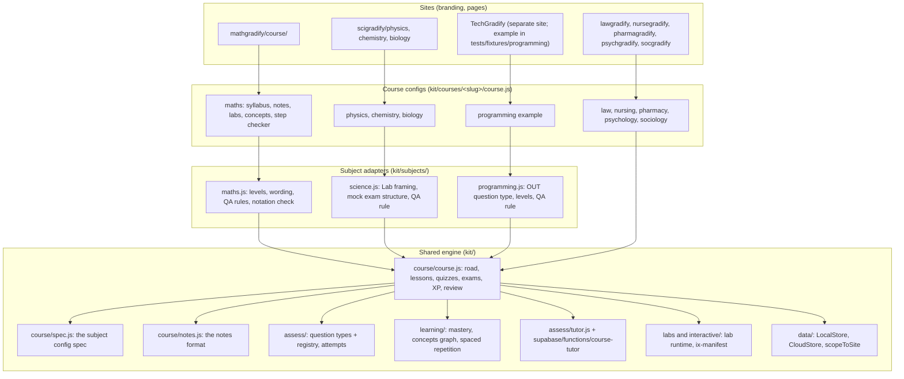

# Gradify platform: one shared engine, subject adapters

Written 7 November 2026. This document covers how every Gradify subject runs on one shared education engine:
- what is shared;
- what a subject adds;
- how to add a subject;
- how changes are versioned and deployed;
- how the shared engine is kept honest across subjects.

MathGradify is the first subject built on the full set of shared pieces (labs in lessons, the concept graph, a subject adapter). SciGradify's three sciences and an example TechGradify course run on the same code.

**The test the owner set:** if the shared AI tutor or mastery engine is improved, can every Gradify site adopt the improvement without rebuilding it? **Yes, and it needs no adoption step.** The engine is one set of modules in `kit/`, and every course page imports it directly:
- the course engine;
- the question types;
- the mastery engine;
- the concept graph;
- the tutor client.

The server-side tutor, `supabase/functions/course-tutor`, is one function shared by every subject. A change to `kit/learning/mastery.js` reaches all nine courses on the next deploy. `tests/cross-site.test.mjs` fails if it breaks any of them.

## 1. Architecture



A site page mounts the engine on a course config, for example `mountCourse(el, course)` in `mathgradify/course/index.html`. A course config is plain data and functions, and it may be defined with a subject adapter. The engine never asks which subject it's running. There is no `if (slug === "maths")` anywhere in `kit/course`, `kit/assess` or `kit/learning`.

## 2. Shared versus subject-specific

| Capability | Shared (in `kit/`, one copy for every subject) | Subject-specific (adapter or course config) |
|---|---|---|
| Curriculum structure | Units, modules, lessons and permanent ids (`syllabus.js`, `ids.js`). Tracks, paths, the road and the review status | The syllabus itself, and the word for a unit ("School", "Module") |
| Notes and notation | The notes format (`kit/course/notes.js`) and inline formatting (`kit/core/text.js`: bold, italic, `code`, ^{sup}, _{sub}) | Content. The maths adapter's bare-caret check |
| Assessment | Choice, true/false, multi, order, match, numerical with tolerance, short answer. Rendering, marking, attempts and versions. The **question-type registry** (`registerQuestionType`) | Extra types registered by an adapter. Programming registers `OUT:`, "predict the output" |
| Mastery | Six-dimension mastery from attempts, confidence calibration, spaced retrieval, lab outcomes (`kit/learning/mastery.js`) | Which lab challenge counts for which lesson (`evidence.js`). The names of the difficulty levels |
| Concept graph | The graph engine (`kit/learning/concepts.js`): validation, ancestors, learning paths, weakness detection, "Builds on" in lessons | Each subject's prerequisite data. Maths: `kit/courses/maths/concepts.js`, 132 modules and 247 links |
| Labs | The lab runtime, lazy mounting, `IX:` placement, the "Try it yourself" fallback, fingerprints and review records | The labs themselves (`kit/labs/maths/`, `kit/labs/chemistry/` …) |
| AI tutor | The client (`kit/assess/tutor.js`), the tutor panel and modes (explain, diagnose, Socratic, examiner…), grounding in canonical notes, and limits | A safety and style line per subject, server-side and keyed by slug (`SITE_RULES` in `kit/assess/tutor.js`). Role-play scenes for law, pharmacy and nursing |
| Workspaces | The workspace slot (`cfg.workspace`: route, engine, cases) | Maths: the step-by-step algebra checker |
| QA | Hard checks for every course. The content checks: escaping, notation braces, separators, NUM keys, arithmetic. Lab coverage and the concept report | Adapter `qa.rules` and `qa.flags`: maths needs worked examples, science needs sources for quantitative values, programming needs code to read |
| Data | Local and cloud stores, `scopeToSite`, the attempt schema (with `subject` = slug) | Nothing |

## 3. Component structure

```
kit/
  course/      course.js (engine), spec.js (config spec), notes.js (notes format), lab-state.js, progress.js, tutor-panel.js
  assess/      model.js (tag registry), types.js (type handlers), questions.js (render, mark, registerQuestionType), attempts.js, tutor.js
  learning/    mastery.js, concepts.js, srs.js, pace.js
  subjects/    define.js (defineCourse), index.js (ADAPTERS), maths.js, science.js, programming.js (+ programming.css)
  courses/     <slug>/course.js, syllabus.js, notes/uNN.js, interactives.js, evidence.js, concepts.js (maths), qa.js, registry.js
  labs/        <subject>/ lab modules
scripts/       qa-courses.mjs, qa-content.mjs + qa-content-run.mjs, lab-coverage.mjs, concept-map.mjs, subject-spec-doc.mjs
tests/         cross-site.test.mjs, concepts.test.mjs, qa-content.test.mjs, lab-coverage.test.mjs … and fixtures/programming/
```

## 4. The subject configuration spec

The spec is code: `FIELDS` and `checkCourse()` in `kit/course/spec.js`. [SUBJECT_CONFIG_SPEC.md](SUBJECT_CONFIG_SPEC.md) is generated from it, and a test fails if the two differ. The spec is checked in three places:
- the engine checks every config when it mounts, and reports problems in the console;
- `tests/cross-site.test.mjs` checks every course;
- the spec rejects unknown fields, so a typo can't silently switch something off.

The spec missed one bug of this kind. Stage A had left `practiceLabel: "Lab"` inside a trailing comment in five course configs: physics, chemistry, biology, psychology and sociology. Their Explore tab read "Practice". That is fixed now.

An adapter is a plain object:

```js
export default {
  id: "maths", name: "Mathematics",
  defaults: { unitWord: "School", levels: [...], practiceLabel: "Explore", tutor: "…" },   // a course's own fields win
  questionTypes: [],                                                                      // { tag, type, label, handler }
  qa: { expert: "…", rules(unit, L, text) { … }, flags(L, text) { … } },
};
```

A course uses its adapter like this:

```js
export default defineCourse(maths, { slug: "maths", units, … })
```

`defineCourse` registers the adapter's question types and fills in its defaults. It also records `adapter: "maths"`, which `scripts/qa-courses.mjs` uses to find the subject's QA rules.

## 5. Proof across three subjects

| | MathGradify | SciGradify | TechGradify |
|---|---|---|---|
| Adapter | `kit/subjects/maths.js` | `kit/subjects/science.js`, shared by physics, chemistry and biology | `kit/subjects/programming.js` |
| What the adapter adds | Levels, wording, Explore label, tutor note, QA rules (worked examples, bare caret), review flags | Site, School and Stage wording, the Lab label and note, the mock exam structure, a QA rule | A new question type (`OUT:`, predict the output), levels Read, Trace and Debug, a QA rule, CSS |
| Courses | `kit/courses/maths/` (live) | `kit/courses/physics`, `chemistry` and `biology` (live) | `tests/fixtures/programming/` (an example; TechGradify is a separate site, not in this repository) |
| Shared capabilities used | Labs in lessons, concept graph, step checker workspace, tutor, mastery | Labs, mock exams, mastery | Concept graph, mastery, XP, quizzes, the new question type |
| Checked by | `tests/cross-site.test.mjs`: spec, every question rendered and marked against its own answer, weakness detection | The same | The same, plus a browser check: the course mounts, and OUT questions mark right and wrong answers |

The migration of maths and the sciences onto adapters changed no behaviour. A field-by-field comparison of each config before and after found only three differences:
- the new `adapter` tag;
- the restored "Lab" label;
- physics now states its existing defaults ("Unit", "Track").

## 6. Migration strategy

Done:
- **Phase 1, the foundations, in this release.**
  - Config spec and checker.
  - Question-type registry.
  - Concept graph engine.
  - Adapters for maths, science and programming.
  - Maths, physics, chemistry and biology defined through adapters.
  - The maths QA rules moved out of the shared QA script into the maths adapter.
  - Cross-site tests.

Next, each a small, separately testable change:
- **Phase 2, the remaining courses.**
  - Give law, nursing, pharmacy, psychology and sociology adapters.
  - Move `lawRules`/`lawFlags`, `nursingRules`/`nursingFlags`, `pharmacyRules`/`pharmacyFlags`, `psychRules` and `socRules` from `scripts/qa-courses.mjs` into them, as was done for maths.
  - Law needs no new question types. Its five-option SBA rule and case and statute cards already run on the shared engine (the `authorities` capability).
  - Psychology and sociology could share a social-science adapter, as the sciences do.
- **Phase 3, the tutor.**
  - Give physics, chemistry, biology, psychology and sociology a `SITE_RULES` line (today they get the default line).
  - Pass the learner's weak prerequisites to the lesson tutor, so "explain" can start from the gap.
  - This needs the `course-tutor` function to be redeployed after `npm run sync`.
- **Phase 4, concept graphs for other subjects.** Write prerequisite data for each course. Every course gets "Builds on" and weakness flags as soon as its config has `concepts`; the engine needs no change.

## 7. Versioning and deployment

- **One repository, one deploy.** Every site in this repository is a folder served from `main` by GitHub Pages. A kit change and the courses that use it ship in the same commit, so no site can run against a kit version it hasn't been tested with. The full test suite and `npm run qa` run before every push to `main`.
- **The kit version.** `kit/VERSION` uses semantic versioning. This release is 1.10.0:
  - new capabilities;
  - nothing removed;
  - every existing config still valid.
  
  Raise the major version when a spec field is removed or changes meaning.
- **Sites outside this repository**, such as TechGradify at techgradify.com, should take the kit at a tagged version (for example a `kit-v1.10.0` tag) rather than following `main`. They upgrade when ready, running `tests/cross-site.test.mjs` against their own course. Repository restructuring, including publishing the kit as a package, was deferred by the owner on 6 November 2026 ([REPOSITORY-STRATEGY.md](REPOSITORY-STRATEGY.md)). Until then, a tag is the lightest way to pin a version.
- **Data.** Each course stores progress under `gradify.course.<slug>`, and every attempt records its `subject`. The cross-site test fails if two courses share a slug. Cloud data goes through `scopeToSite(store, site)`, so a site reads only its own documents and cards.

  One Gradify account spans the family by design (`gradify.config.js`). Data is seen across subjects only on the account's own pages: the Gradify app and LifeOS, which the learner opens themselves. Row-level security keeps each learner's rows to that learner.
- **Branding stays per site.** Each site keeps its own:
  - pages, colours and icon (`kit/core/sites.js`);
  - course theme (`cfg.theme`);
  - wording (adapter defaults).

## 8. Cross-site compatibility suite

`tests/cross-site.test.mjs` checks:
- every course config, plus the TechGradify example, fits the spec;
- slugs are unique;
- each subject is defined by the right adapter;
- every question in every written lesson of every course renders, and marks its own answer correct (about 13,000 auto-marked questions);
- a registered question type works end to end and can't clash with an existing one;
- weakness detection finds a planted weak prerequisite in maths and in programming, through the same function;
- the generated spec doc is current.

It runs in `npm test` before every deploy.

## 9. How to add a new subject

1. **Choose or write an adapter.** If an existing adapter fits (a new science, say), use it. Otherwise copy `kit/subjects/programming.js`:
   - keep `defaults` for wording and levels;
   - add a question type only if the shared types can't express the subject's tasks;
   - write one or two `qa.rules` a script can check;
   - add it to `kit/subjects/index.js`.
2. **Write the course config** in `kit/courses/<slug>/course.js` with `defineCourse(adapter, { slug, name, units, tracks, paths, written, notes })`:
   - put the syllabus in `syllabus.js`;
   - write notes as `notes/uNN.js` in the notes format (see `kit/course/notes.js`);
   - run `npm test`, and `checkCourse` reports anything missing.
3. **Add a page**, for example `<site>gradify/course/index.html` copied from `mathgradify/course/index.html`, changing the course import and the site name.
4. **Optional capabilities**, each a config field:
   - `interactives` and `evidence` for labs (placed in notes with `IX:`);
   - `concepts` for the concept graph;
   - `workspace` for a subject tool;
   - `writing` for rubric-marked tasks;
   - `exams` for mock exams.
5. **QA.** Add the course to `COURSES` in `scripts/qa-courses.mjs` (its adapter supplies the rules), add `kit/courses/<slug>/qa.js`, and run `npm run qa`. Hard checks must pass. Content checks, lab coverage and the concept report cover the new course automatically.
6. **Tutor.** Add a `SITE_RULES` line for the slug in `kit/assess/tutor.js`, then run `npm run sync` and redeploy `course-tutor`.

## 10. Adaptive learning: what exists and what to build next

What's in place, measured from the learner's own evidence:
- **Attempts** record question id and version, type, difficulty, objectives, lesson, unit, response, score, confidence, time, a misconception (the wrong option chosen) and the marking status.
- **Six-dimension mastery** per lesson, school or course, with certainty levels. It reports "insufficient" rather than guessing.
- **Spaced retrieval** of course questions.
- **Lab outcomes** (success, assisted, unsuccessful, attempted) counted as Application evidence.
- **The concept graph.** Lessons now flag a weak prerequisite once mastery there is measured and below 60%.

**Recommendation: don't change the database yet.** Mastery and weaknesses are derived on read from attempts, which already hold everything the engine needs. That keeps the learner model explainable ("based on your 12 answers in Differentiation") and lets the model improve without migrating stored values.

In order, the next steps are:
1. **Remediation paths.** `learningPath(graph, target, isSecure)` already gives the study order to a target, skipping secure modules. Surface it on the Mastery page as "To reach Integration, review Differentiation first".
2. **Tutor context.** Send the weak prerequisites with "explain" and "diagnose" requests (Phase 3 above).
3. **Misconception mapping.** Link the wrong options learners choose most to the lessons' `!:` misconception lines, so remediation targets the specific error.
4. **Persist only for speed.** If deriving mastery from thousands of attempts becomes slow, add a materialised per-learner, per-module mastery table, rebuilt from attempts. Keep attempts the source of truth.

## 11. What this doesn't do

- TechGradify is a separate site and isn't built here. The programming adapter and example course show it would run on this engine, but the example isn't published.
- The QA rules for law, nursing, pharmacy, psychology and sociology are still in `scripts/qa-courses.mjs` (Phase 2).
- Physics, chemistry, biology, psychology and sociology get the tutor's default rules line (Phase 3).
- The concept graph, like every lesson, awaits expert review. Automated checks show its structure is sound (no cycles, no unknown references), not that every prerequisite is the right one.
