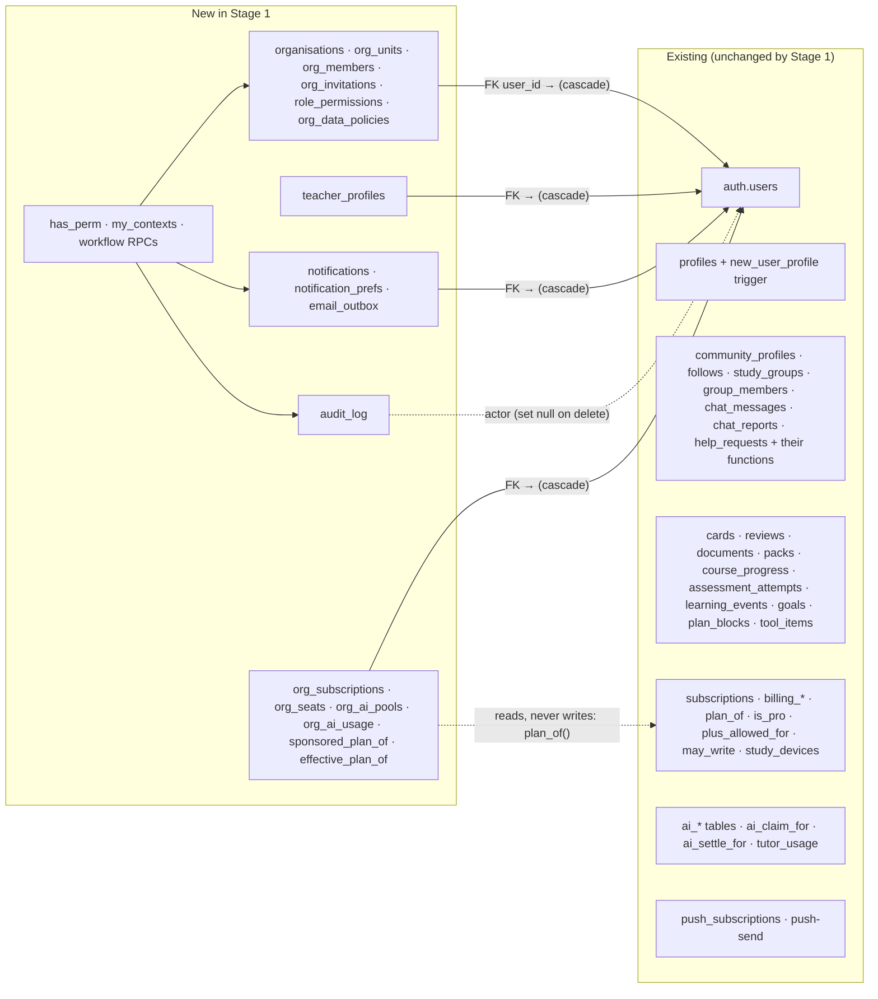

# Stage 1: what it touches, and what it doesn't

Written **before** the Stage 1 migrations, as the decisions of 19 November require. Stage 1 covers:
- identity and contextual roles;
- organisations, units, members and invitations;
- independent teachers;
- permissions and row-level security;
- the audit log;
- notifications and email;
- workspace switching;
- sponsored entitlements and AI allowance foundations.

See `BLENDED-LEARNING-AUDIT.md` §5 and §9a.

## The diagram

**The only links into existing objects:**
- Foreign keys to `auth.users`, the same as every existing table.
- One **read-only** call: `effective_plan_of()` reads `plan_of()`.

Nothing in Stage 1 writes to, alters or adds a policy to any existing table or function.

## Existing features, one by one

| Feature | Objects | Stage 1 effect | How it's proved |
|---|---|---|---|
| Sign-in and accounts | `auth.users`, `profiles`, `new_user_profile()` | none: no column, trigger or policy change | regression test: a new user still gets a profile; profile policies identical |
| Friends | `follows`, `find_by_friend_code()`, `my_friends()` | none | regression test: following and `my_friends()` behave as before; catalogue snapshot identical |
| Study groups and chat | `study_groups`, `group_members`, `chat_messages`, `chat_reports`, `is_group_member()` | none. Organisations are a **separate** structure, not a change to groups (the community rebuild is a later stage) | regression test: joining, chatting and reporting behave as before |
| Community profiles and tutors | `community_profiles`, `community_directory()`, `help_requests` | none (the safeguarding review, D3, is separate) | catalogue snapshot identical |
| Learning progress | `cards`, `reviews`, `course_progress`, `assessment_attempts`, `learning_events`, `goals`, … | none. **No new policy lets anyone else read them (D10)** | test: an organisation admin and a co-member can read none of another member's learning rows |
| Subscriptions and plans | `subscriptions`, `plan_of()`, `is_pro()`, `plus_allowed_for()`, `may_write()` | none. `effective_plan_of()` is new and **not yet used** by any existing check | test: `plan_of()` is unchanged; for every user without a seat, `effective_plan_of()` = `plan_of()` |
| AI allowances | `ai_claim_for()`, `ai_settle_for()`, `ai_limits` | none. Organisation pools are tables and read functions only, not yet used when an AI request is counted | catalogue snapshot identical |
| Push notifications | `push_subscriptions`, `push-send` | none. In-app notifications are a new table | — |
| The app (browser) | `kit/app/main.js` (`NAV`, `routes`), Settings | **additive:** a workspace switcher, `#/org…`, `#/join/…` and `#/inbox` routes, and "Teach on Gradify" in Settings. Personal mode looks and works exactly as now | the existing app tests and browser journeys |
| Offline shell | `sw.js` | new files added to `SHELL`, `CACHE` bumped | `tests/offline.test.mjs` |

**Regression guard.** `tests/stage1-db.test.mjs` takes a snapshot of every existing table's columns, policies and grants, and every existing function's definition and grants. It does this after all the earlier migrations and again after Stage 1, and fails on any difference.

## Two things that are deliberately not wired yet

Each changes a function that every existing learner's billing or AI use goes through. So each is a separate, approved step with its own regression tests:
1. **`plan_of()` → `effective_plan_of()`**, so a sponsored seat actually grants Plus or Pro.
2. **`ai_claim_for()` counting against an organisation's AI pool** before the member's personal allowance, recording each use in `org_ai_usage`.

## Naming, deletion and ordering

- **No name collisions.** None of the new tables or functions exists today (checked against all 23 migrations).
- **Deleting a person:**
  - their memberships, seats, teacher profile, notifications and preferences go with them;
  - **audit rows stay, with the actor set to null**, so an organisation's history survives but no longer names them;
  - an organisation's last owner can't be removed through the RPCs; the account has to be transferred or the organisation archived first.
- **Deleting an organisation** removes its units, members, invitations, policies, subscriptions, seats and pools. Its audit rows stay, keeping the `org_id` as a plain value. Organisations are **archived**, not deleted, through the RPCs.
- **Order:** the Stage 1 migrations are numbered after `20261119120000` (the last on `main`) and after #116's `20261120120000`, so they sort last whichever merges first.

## Staging (D1)

- **Production:** `ezlohntrnassgsbofcfc` (from `gradify.config.js` and `docs/BACKEND-LOG.md`).
- **Staging: doesn't exist yet.** Creating a Supabase project needs the owner's account. This session can't reach Supabase: its Supabase connection failed (proxy tunnel error), and no staging credentials exist.
- **Until it exists,** Stage 1 is built and tested against a real PostgreSQL in the test suite (pglite with Supabase's roles and default privileges, every repository migration applied in order). That's the same harness the production rehearsals use. It is **not** a substitute for staging: Auth emails, Edge Functions, Realtime and Storage can only be checked there.
- **Before Stage 1 goes anywhere,** the owner should:
  1. create the staging project;
  2. read the production migration history (7 migrations after 10 November aren't recorded as applied);
  3. apply the repository's migrations to staging, then Stage 1's;
  4. run `npm run verify:backend` with synthetic accounts.
- `docs/STAGING.md` lists the steps.
