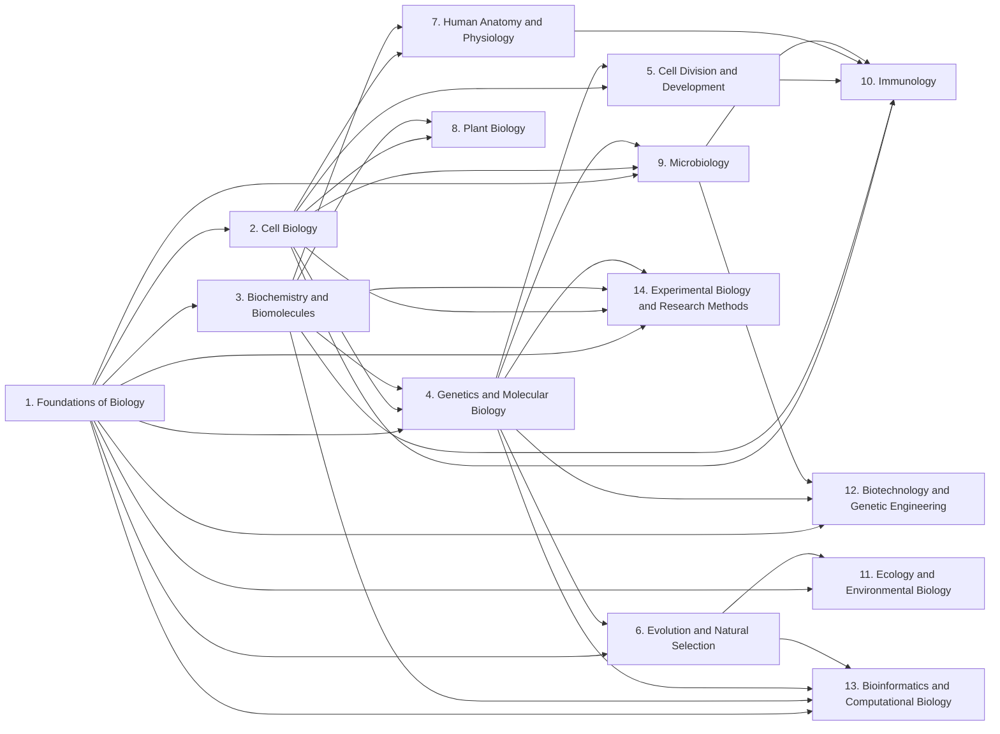

# SciGradify: concept graph

Generated by `npm run qa` from `kit/courses/biology/concepts.js` by the shared engine `kit/learning/concepts.js`. The graph says which modules each module builds on. The course uses it to show "Builds on" in every lesson and to flag a prerequisite when the learner's own answers show it's weak. Like the lessons, it awaits expert review.

| Modules | Prerequisite links | Lesson-level links | Starting points | Longest chain | Unknown references | Cycles |
|---|---|---|---|---|---|---|
| 82 | 131 | 0 | 2 | 15 modules | 0 | 0 |

## Sequencing: prerequisites taught later

Modules that build on something placed later in the course. Learners following the course in order meet these before their foundations: either the learner is pointed back (the "Builds on" links do this), or the order should change. 0 found.

| Module | Needs | |
|---|---|---|

## Most depended-on modules

A weakness in these puts the most later modules at risk.

| Module | Modules that build on it (directly or not) |
|---|---|
| The living world (School 1) | 75 |
| Classifying life (School 1) | 68 |
| Cells and cell types (School 2) | 63 |
| Organelles (School 2) | 57 |
| Water and the chemistry of life (School 3) | 52 |
| Carbohydrates (School 3) | 46 |
| Nucleic acids and energy (School 3) | 45 |
| DNA and genomes (School 4) | 43 |
| Proteins (School 3) | 35 |
| From gene to protein (School 4) | 29 |

## School-level map

## Every module's prerequisites

| Module | Builds on |
|---|---|
| The living world (School 1) | (a starting point) |
| Classifying life (School 1) | The living world (School 1) |
| The scientific method (School 1) | (a starting point) |
| Measurement and data (School 1) | The scientific method (School 1) |
| Ethics in research (School 1) | The scientific method (School 1) |
| Cells and cell types (School 2) | The living world (School 1); Classifying life (School 1) |
| Organelles (School 2) | Cells and cell types (School 2) |
| Membranes and transport (School 2) | Organelles (School 2) |
| Specialisation and communication (School 2) | Organelles (School 2); Membranes and transport (School 2) |
| Water and the chemistry of life (School 3) | The living world (School 1) |
| Carbohydrates (School 3) | Water and the chemistry of life (School 3) |
| Lipids (School 3) | Water and the chemistry of life (School 3) |
| Proteins (School 3) | Water and the chemistry of life (School 3) |
| Enzymes (School 3) | Proteins (School 3) |
| Nucleic acids and energy (School 3) | Carbohydrates (School 3) |
| DNA and genomes (School 4) | Nucleic acids and energy (School 3); Organelles (School 2) |
| From gene to protein (School 4) | DNA and genomes (School 4); Proteins (School 3) |
| Gene regulation (School 4) | From gene to protein (School 4) |
| Mutation and DNA damage (School 4) | DNA and genomes (School 4); From gene to protein (School 4) |
| Patterns of inheritance (School 4) | DNA and genomes (School 4) |
| Populations and genomics (School 4) | Patterns of inheritance (School 4); Mutation and DNA damage (School 4); Measurement and data (School 1) |
| The cell cycle and division (School 5) | DNA and genomes (School 4); Organelles (School 2) |
| Control and cell death (School 5) | The cell cycle and division (School 5); Specialisation and communication (School 2) |
| Cancer (School 5) | Control and cell death (School 5); Mutation and DNA damage (School 4) |
| Stem cells and early development (School 5) | The cell cycle and division (School 5); Specialisation and communication (School 2) |
| Signalling, fate and regeneration (School 5) | Stem cells and early development (School 5); Gene regulation (School 4) |
| Evidence and natural selection (School 6) | Patterns of inheritance (School 4); Classifying life (School 1) |
| Sources of evolutionary change (School 6) | Evidence and natural selection (School 6); Mutation and DNA damage (School 4); Populations and genomics (School 4) |
| Selection and fitness (School 6) | Evidence and natural selection (School 6) |
| Speciation (School 6) | Sources of evolutionary change (School 6); Selection and fitness (School 6) |
| Phylogenetics and ancestry (School 6) | Evidence and natural selection (School 6); DNA and genomes (School 4) |
| Evolution today (School 6) | Selection and fitness (School 6); Sources of evolutionary change (School 6) |
| Body organisation and homeostasis (School 7) | Specialisation and communication (School 2) |
| Nervous and endocrine systems (School 7) | Body organisation and homeostasis (School 7); Membranes and transport (School 2) |
| Cardiovascular system (School 7) | Body organisation and homeostasis (School 7) |
| Respiratory system (School 7) | Cardiovascular system (School 7); Membranes and transport (School 2) |
| Digestive system (School 7) | Body organisation and homeostasis (School 7); Enzymes (School 3) |
| Renal system (School 7) | Body organisation and homeostasis (School 7); Membranes and transport (School 2) |
| Movement and support (School 7) | Nervous and endocrine systems (School 7); Proteins (School 3) |
| Defence, reproduction and regulation (School 7) | Nervous and endocrine systems (School 7); Cardiovascular system (School 7) |
| Plant structure (School 8) | Cells and cell types (School 2) |
| Transport in plants (School 8) | Plant structure (School 8); Membranes and transport (School 2) |
| Nutrition and photosynthesis (School 8) | Plant structure (School 8); Enzymes (School 3); Nucleic acids and energy (School 3) |
| Plant hormones and responses (School 8) | Plant structure (School 8); Specialisation and communication (School 2) |
| Plant reproduction (School 8) | Plant structure (School 8) |
| Stress and biotechnology (School 8) | Plant hormones and responses (School 8) |
| Bacteria (School 9) | Cells and cell types (School 2); DNA and genomes (School 4) |
| Viruses (School 9) | From gene to protein (School 4) |
| Fungi, protozoa and archaea (School 9) | Cells and cell types (School 2); Classifying life (School 1) |
| Microbes and their hosts (School 9) | Bacteria (School 9) |
| Infection and disease (School 9) | Bacteria (School 9); Viruses (School 9) |
| Controlling microbes (School 9) | Infection and disease (School 9) |
| Microbiology in practice (School 9) | Bacteria (School 9); Measurement and data (School 1) |
| Foundations of immunity (School 10) | Defence, reproduction and regulation (School 7); Infection and disease (School 9) |
| Immune cells (School 10) | Foundations of immunity (School 10); Specialisation and communication (School 2) |
| Antigen recognition and signalling (School 10) | Immune cells (School 10); Proteins (School 3) |
| Inflammation, complement and memory (School 10) | Antigen recognition and signalling (School 10) |
| Immune disorders (School 10) | Inflammation, complement and memory (School 10) |
| Clinical immunology (School 10) | Immune disorders (School 10); Cancer (School 5) |
| Organisms and ecosystems (School 11) | The living world (School 1); Classifying life (School 1) |
| Energy flow (School 11) | Organisms and ecosystems (School 11) |
| Nutrient cycles (School 11) | Energy flow (School 11) |
| Populations and interactions (School 11) | Organisms and ecosystems (School 11); Measurement and data (School 1) |
| Communities and biodiversity (School 11) | Populations and interactions (School 11); Speciation (School 6) |
| Conservation and environmental change (School 11) | Communities and biodiversity (School 11); Nutrient cycles (School 11) |
| Recombinant DNA (School 12) | DNA and genomes (School 4); Bacteria (School 9) |
| Amplifying and reading DNA (School 12) | DNA and genomes (School 4) |
| Gene editing and expression (School 12) | Recombinant DNA (School 12); From gene to protein (School 4) |
| Medical biotechnology (School 12) | Gene editing and expression (School 12); Mutation and DNA damage (School 4) |
| Industry, safety and ethics (School 12) | Gene editing and expression (School 12); Ethics in research (School 1) |
| Data and sequences (School 13) | From gene to protein (School 4) |
| Alignment and phylogenetics (School 13) | Data and sequences (School 13); Phylogenetics and ancestry (School 6) |
| Genomes and gene expression (School 13) | Data and sequences (School 13); Gene regulation (School 4) |
| Omics and structure (School 13) | Data and sequences (School 13); Proteins (School 3) |
| Networks and systems (School 13) | Genomes and gene expression (School 13) |
| Genomic medicine and drug discovery (School 13) | Populations and genomics (School 4); Genomes and gene expression (School 13) |
| Data science and reproducibility (School 13) | Data and sequences (School 13); Measurement and data (School 1) |
| Designing experiments (School 14) | The scientific method (School 1) |
| Imaging and cell culture (School 14) | Cells and cell types (School 2) |
| Molecular and biochemical techniques (School 14) | DNA and genomes (School 4); Proteins (School 3) |
| Statistics and visualisation (School 14) | Measurement and data (School 1) |
| Research practice and integrity (School 14) | Designing experiments (School 14); Ethics in research (School 1) |
