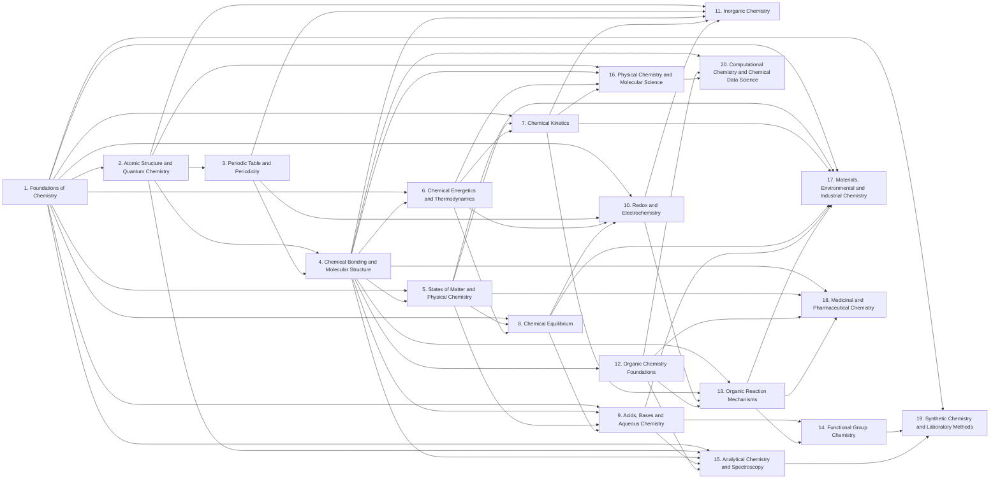

# SciGradify: concept graph

Generated by `npm run qa` from `kit/courses/chemistry/concepts.js` by the shared engine `kit/learning/concepts.js`. The graph says which modules each module builds on. The course uses it to show "Builds on" in every lesson and to flag a prerequisite when the learner's own answers show it's weak. Like the lessons, it awaits expert review.

| Modules | Prerequisite links | Lesson-level links | Starting points | Longest chain | Unknown references | Cycles |
|---|---|---|---|---|---|---|
| 99 | 165 | 0 | 1 | 18 modules | 0 | 0 |

## Sequencing: prerequisites taught later

Modules that build on something placed later in the course. Learners following the course in order meet these before their foundations: either the learner is pointed back (the "Builds on" links do this), or the order should change. 0 found.

| Module | Needs | |
|---|---|---|

## Most depended-on modules

A weakness in these puts the most later modules at risk.

| Module | Modules that build on it (directly or not) |
|---|---|
| Matter (School 1) | 98 |
| Atoms, formulae and equations (School 1) | 97 |
| The nuclear atom (School 2) | 85 |
| Electrons and orbitals (School 2) | 83 |
| The periodic table (School 3) | 81 |
| Energies and spectra (School 2) | 78 |
| Periodic trends (School 3) | 76 |
| Types of bond (School 4) | 73 |
| Drawing molecules (School 4) | 51 |
| Shape and polarity (School 4) | 50 |

## School-level map

## Every module's prerequisites

| Module | Builds on |
|---|---|
| Matter (School 1) | (a starting point) |
| Atoms, formulae and equations (School 1) | Matter (School 1) |
| The mole and stoichiometry (School 1) | Atoms, formulae and equations (School 1) |
| Solutions and measurement (School 1) | The mole and stoichiometry (School 1) |
| The nuclear atom (School 2) | Atoms, formulae and equations (School 1) |
| Electrons and orbitals (School 2) | The nuclear atom (School 2) |
| Energies and spectra (School 2) | Electrons and orbitals (School 2) |
| The quantum atom (School 2) | Electrons and orbitals (School 2); Energies and spectra (School 2) |
| The periodic table (School 3) | The nuclear atom (School 2) |
| Blocks of the table (School 3) | The periodic table (School 3); Electrons and orbitals (School 2) |
| The groups (School 3) | Blocks of the table (School 3) |
| Transition and inner transition elements (School 3) | Blocks of the table (School 3) |
| Periodic trends (School 3) | The periodic table (School 3); Energies and spectra (School 2) |
| Types of bond (School 4) | Periodic trends (School 3) |
| Drawing molecules (School 4) | Types of bond (School 4) |
| Shape and polarity (School 4) | Drawing molecules (School 4) |
| Intermolecular forces (School 4) | Shape and polarity (School 4) |
| Bond and lattice energies (School 4) | Types of bond (School 4); Energies and spectra (School 2) |
| Bonding theories (School 4) | Shape and polarity (School 4); The quantum atom (School 2) |
| Solids (School 4) | Types of bond (School 4) |
| Gases (School 5) | The mole and stoichiometry (School 1) |
| Liquids and phase changes (School 5) | Intermolecular forces (School 4) |
| Solids (School 5) | Solids (School 4) |
| Solutions (School 5) | Solutions and measurement (School 1); Intermolecular forces (School 4) |
| Transport and surface properties (School 5) | Intermolecular forces (School 4); Liquids and phase changes (School 5) |
| Energy changes (School 6) | Atoms, formulae and equations (School 1) |
| Enthalpy (School 6) | Energy changes (School 6); The mole and stoichiometry (School 1); Bond and lattice energies (School 4) |
| Entropy and free energy (School 6) | Enthalpy (School 6) |
| The laws of thermodynamics (School 6) | Entropy and free energy (School 6) |
| Rates and collisions (School 7) | Energy changes (School 6); Gases (School 5) |
| Catalysis (School 7) | Rates and collisions (School 7) |
| Rate laws (School 7) | Rates and collisions (School 7); Solutions and measurement (School 1) |
| Temperature and mechanism (School 7) | Rate laws (School 7); Catalysis (School 7) |
| Equilibrium (School 8) | Solutions and measurement (School 1); Gases (School 5) |
| Shifting equilibrium (School 8) | Equilibrium (School 8); Energy changes (School 6) |
| Equilibrium in practice (School 8) | Shifting equilibrium (School 8); Entropy and free energy (School 6) |
| Acid-base theories (School 9) | Atoms, formulae and equations (School 1); Types of bond (School 4) |
| Strength and pH (School 9) | Acid-base theories (School 9); Equilibrium (School 8) |
| Buffers (School 9) | Strength and pH (School 9) |
| Titrations (School 9) | Strength and pH (School 9) |
| Solubility and complex equilibria (School 9) | Strength and pH (School 9); Solutions (School 5) |
| Redox (School 10) | Atoms, formulae and equations (School 1); Periodic trends (School 3) |
| Electrochemical cells (School 10) | Redox (School 10); Entropy and free energy (School 6); Equilibrium (School 8) |
| Electrolysis (School 10) | Redox (School 10); The mole and stoichiometry (School 1) |
| Applied electrochemistry (School 10) | Electrochemical cells (School 10); Electrolysis (School 10) |
| Main-group chemistry (School 11) | The groups (School 3); Types of bond (School 4) |
| Coordination chemistry (School 11) | Transition and inner transition elements (School 3); Types of bond (School 4) |
| Bonding and properties of complexes (School 11) | Coordination chemistry (School 11); The quantum atom (School 2) |
| Organometallics and catalysis (School 11) | Coordination chemistry (School 11); Catalysis (School 7) |
| Applied inorganic chemistry (School 11) | Main-group chemistry (School 11); Redox (School 10) |
| f-block chemistry (School 11) | Transition and inner transition elements (School 3) |
| Carbon and hydrocarbons (School 12) | Types of bond (School 4); Shape and polarity (School 4) |
| Naming and functional groups (School 12) | Carbon and hydrocarbons (School 12) |
| Isomerism (School 12) | Naming and functional groups (School 12) |
| Chirality and stereochemistry (School 12) | Isomerism (School 12) |
| Organic reactions (School 12) | Naming and functional groups (School 12) |
| Mechanism basics (School 13) | Organic reactions (School 12); Shape and polarity (School 4); Rates and collisions (School 7) |
| Substitution and elimination (School 13) | Mechanism basics (School 13); Chirality and stereochemistry (School 12) |
| Addition and aromatic substitution (School 13) | Mechanism basics (School 13) |
| Redox and other reaction types (School 13) | Mechanism basics (School 13); Redox (School 10) |
| Selectivity (School 13) | Substitution and elimination (School 13); Addition and aromatic substitution (School 13) |
| Oxygen-containing groups (School 14) | Substitution and elimination (School 13); Addition and aromatic substitution (School 13); Redox and other reaction types (School 13) |
| Nitrogen, halogen and sulfur compounds (School 14) | Substitution and elimination (School 13); Acid-base theories (School 9) |
| Carbonyl and heterocyclic chemistry (School 14) | Oxygen-containing groups (School 14); Addition and aromatic substitution (School 13) |
| Synthesis (School 14) | Oxygen-containing groups (School 14); Nitrogen, halogen and sulfur compounds (School 14); Selectivity (School 13) |
| Principles of analysis (School 15) | Solutions and measurement (School 1); Titrations (School 9) |
| Spectroscopy (School 15) | Naming and functional groups (School 12); Energies and spectra (School 2) |
| Mass spectrometry (School 15) | Naming and functional groups (School 12); The nuclear atom (School 2) |
| Other techniques (School 15) | Spectroscopy (School 15); Solids (School 4) |
| Chromatography (School 15) | Intermolecular forces (School 4); Mass spectrometry (School 15) |
| Structure and validation (School 15) | Spectroscopy (School 15); Mass spectrometry (School 15); Principles of analysis (School 15) |
| Quantum chemistry (School 16) | The quantum atom (School 2); Bonding theories (School 4) |
| Spectroscopy (School 16) | Quantum chemistry (School 16); Energies and spectra (School 2) |
| Statistical thermodynamics (School 16) | The laws of thermodynamics (School 6); Quantum chemistry (School 16) |
| Kinetics and surfaces (School 16) | Temperature and mechanism (School 7); Intermolecular forces (School 4) |
| Photochemistry and molecular interactions (School 16) | Spectroscopy (School 16); Intermolecular forces (School 4) |
| Materials (School 17) | Solids (School 5); Addition and aromatic substitution (School 13) |
| Environmental chemistry (School 17) | Gases (School 5); Solubility and complex equilibria (School 9) |
| Industrial chemistry (School 17) | Equilibrium in practice (School 8); Catalysis (School 7) |
| Sustainability (School 17) | Industrial chemistry (School 17); The mole and stoichiometry (School 1) |
| Drugs and targets (School 18) | Naming and functional groups (School 12) |
| Molecular recognition (School 18) | Drugs and targets (School 18); Intermolecular forces (School 4); Chirality and stereochemistry (School 12) |
| From hit to drug candidate (School 18) | Molecular recognition (School 18); Solutions (School 5) |
| Pharmacokinetics (School 18) | From hit to drug candidate (School 18); Redox and other reaction types (School 13) |
| Drug design methods (School 18) | Molecular recognition (School 18) |
| Prodrugs, formulation and computation (School 18) | Pharmacokinetics (School 18); Drug design methods (School 18) |
| Safety and planning (School 19) | The mole and stoichiometry (School 1) |
| Core techniques (School 19) | Safety and planning (School 19); Chromatography (School 15) |
| Yield, purity and monitoring (School 19) | Core techniques (School 19) |
| Synthesis planning (School 19) | Synthesis (School 14) |
| Good practice (School 19) | Synthesis planning (School 19); Yield, purity and monitoring (School 19) |
| Representing molecules (School 20) | Naming and functional groups (School 12) |
| Databases and visualisation (School 20) | Representing molecules (School 20) |
| Conformations and force fields (School 20) | Isomerism (School 12); Intermolecular forces (School 4) |
| Quantum chemical methods (School 20) | Quantum chemistry (School 16) |
| Simulation (School 20) | Conformations and force fields (School 20); Statistical thermodynamics (School 16) |
| Docking and screening (School 20) | Conformations and force fields (School 20); Intermolecular forces (School 4) |
| Cheminformatics and machine learning (School 20) | Representing molecules (School 20); Databases and visualisation (School 20) |
| Data and reproducibility (School 20) | Databases and visualisation (School 20) |
