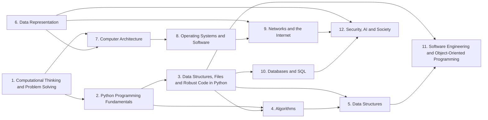

# TechGradify · ForgeLab: concept graph

Generated by `npm run qa` from `kit/courses/computing/concepts.js` by the shared engine `kit/learning/concepts.js`. The graph says which modules each module builds on. The course uses it to show "Builds on" in every lesson and to flag a prerequisite when the learner's own answers show it's weak. Like the lessons, it awaits expert review.

| Modules | Prerequisite links | Lesson-level links | Starting points | Longest chain | Unknown references | Cycles |
|---|---|---|---|---|---|---|
| 41 | 52 | 0 | 3 | 11 modules | 0 | 0 |

## Sequencing: prerequisites taught later

Modules that build on something placed later in the course. Learners following the course in order meet these before their foundations: either the learner is pointed back (the "Builds on" links do this), or the order should change. 0 found.

| Module | Needs | |
|---|---|---|

## Most depended-on modules

A weakness in these puts the most later modules at risk.

| Module | Modules that build on it (directly or not) |
|---|---|
| Thinking computationally (School 1) | 26 |
| Representing algorithms (School 1) | 25 |
| Logic (School 1) | 24 |
| Getting started (School 2) | 23 |
| Control flow (School 2) | 22 |
| Text and functions (School 2) | 21 |
| Built-in data structures (School 3) | 17 |
| Number systems (School 6) | 14 |
| The processor (School 7) | 10 |
| Memory and storage (School 7) | 7 |

## School-level map

## Every module's prerequisites

| Module | Builds on |
|---|---|
| Thinking computationally (School 1) | (a starting point) |
| Representing algorithms (School 1) | Thinking computationally (School 1) |
| Logic (School 1) | (a starting point) |
| Beyond the sequential (School 1) | Representing algorithms (School 1) |
| Getting started (School 2) | Representing algorithms (School 1) |
| Control flow (School 2) | Getting started (School 2); Logic (School 1) |
| Text and functions (School 2) | Control flow (School 2) |
| Built-in data structures (School 3) | Text and functions (School 2) |
| Files (School 3) | Built-in data structures (School 3) |
| Robust programs (School 3) | Text and functions (School 2) |
| Searching (School 4) | Built-in data structures (School 3) |
| Sorting (School 4) | Built-in data structures (School 3) |
| Analysing algorithms (School 4) | Searching (School 4); Sorting (School 4) |
| Recursion (School 4) | Text and functions (School 2) |
| Graph algorithms (School 4) | Analysing algorithms (School 4); Built-in data structures (School 3) |
| Problem-solving strategies (School 4) | Recursion (School 4); Sorting (School 4) |
| Linear structures (School 5) | Built-in data structures (School 3) |
| Trees and graphs (School 5) | Linear structures (School 5); Recursion (School 4) |
| Hashing (School 5) | Linear structures (School 5) |
| Design choices (School 5) | Trees and graphs (School 5); Hashing (School 5); Analysing algorithms (School 4) |
| Number systems (School 6) | (a starting point) |
| Text, images and sound (School 6) | Number systems (School 6) |
| Compression, encryption and errors (School 6) | Text, images and sound (School 6) |
| The processor (School 7) | Number systems (School 6) |
| Memory and storage (School 7) | The processor (School 7) |
| Low-level programming (School 7) | The processor (School 7) |
| Hardware and circuits (School 7) | Logic (School 1); Number systems (School 6) |
| Systems software (School 8) | Memory and storage (School 7) |
| Translators and languages (School 8) | Low-level programming (School 7) |
| Kinds of software (School 8) | Systems software (School 8) |
| Network fundamentals (School 9) | Text, images and sound (School 6); Systems software (School 8) |
| Protocols (School 9) | Network fundamentals (School 9); Number systems (School 6) |
| The web (School 9) | Protocols (School 9) |
| Relational databases (School 10) | Files (School 3) |
| SQL (School 10) | Relational databases (School 10) |
| Managing data (School 10) | SQL (School 10) |
| Building software (School 11) | Robust programs (School 3) |
| Object-oriented programming (School 11) | Built-in data structures (School 3); Linear structures (School 5) |
| Cyber security (School 12) | Protocols (School 9); SQL (School 10); Compression, encryption and errors (School 6) |
| Artificial intelligence (School 12) | Managing data (School 10) |
| Law and ethics (School 12) | Cyber security (School 12); Managing data (School 10) |
