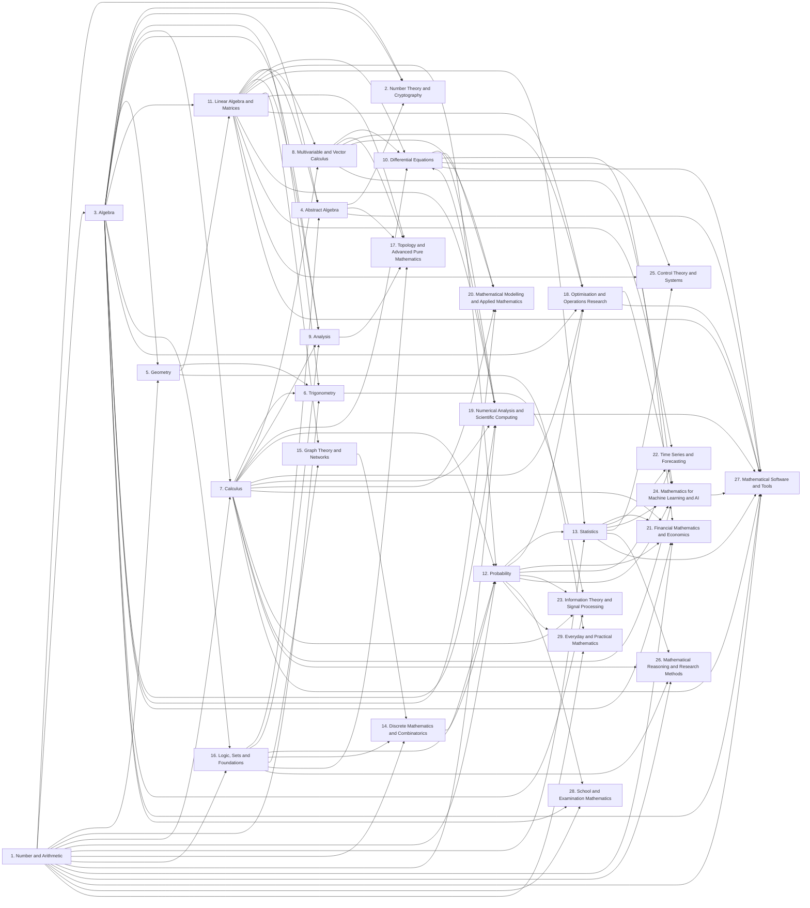

# MathGradify: concept graph

Generated by `npm run qa` from `kit/courses/maths/concepts.js` by the shared engine `kit/learning/concepts.js`. The graph says which modules each module builds on. The course uses it to show "Builds on" in every lesson and to flag a prerequisite when the learner's own answers show it's weak. Like the lessons, it awaits expert review.

| Modules | Prerequisite links | Lesson-level links | Starting points | Longest chain | Unknown references | Cycles |
|---|---|---|---|---|---|---|
| 132 | 247 | 0 | 1 | 15 modules | 0 | 0 |

## Sequencing: prerequisites taught later

Modules that build on something placed later in the course. Learners following the course in order meet these before their foundations: either the learner is pointed back (the "Builds on" links do this), or the order should change. 22 found.

| Module | Needs | |
|---|---|---|
| Elementary number theory (School 2) | Foundations (School 3) | 1 school later |
| Advanced number theory (School 2) | Rings, fields and modules (School 4) | 2 schools later |
| Groups (School 4) | Sets (School 16) | 12 schools later |
| Groups (School 4) | Relations and orders (School 16) | 12 schools later |
| Groups (School 4) | Proof (School 16) | 12 schools later |
| Representations and Lie theory (School 4) | Linear maps (School 11) | 7 schools later |
| Transformations and symmetry (School 5) | Coordinate and vector geometry (School 5) | later in the same school |
| Hyperbolic functions and Fourier series (School 6) | Integration (School 7) | 1 school later |
| Hyperbolic functions and Fourier series (School 6) | Sequences and series (School 7) | 1 school later |
| Multivariable calculus (School 8) | Vectors and vector spaces (School 11) | 3 schools later |
| Further calculus (School 8) | Matrices (School 11) | 3 schools later |
| Real and complex analysis (School 9) | Proof (School 16) | 7 schools later |
| Functional analysis (School 9) | Vectors and vector spaces (School 11) | 2 schools later |
| Functional analysis (School 9) | Orthogonality (School 11) | 2 schools later |
| Numerical solutions (School 10) | Errors and stability (School 19) | 9 schools later |
| Dynamical systems (School 10) | Eigenvalues and diagonalisation (School 11) | 1 school later |
| Foundations of probability (School 12) | Sets (School 16) | 4 schools later |
| Discrete distributions (School 12) | Counting (School 14) | 2 schools later |
| Counting (School 14) | Sets (School 16) | 2 schools later |
| Advanced combinatorics (School 14) | Graphs (School 15) | 1 school later |
| Codes, algorithms and computation (School 14) | Logic (School 16) | 2 schools later |
| Graphs (School 15) | Sets (School 16) | 1 school later |

## Most depended-on modules

A weakness in these puts the most later modules at risk.

| Module | Modules that build on it (directly or not) |
|---|---|
| Number systems (School 1) | 131 |
| Factors and primes (School 1) | 119 |
| Fractions, decimals and percentages (School 1) | 118 |
| Foundations (School 3) | 101 |
| Equations and inequalities (School 3) | 91 |
| Powers, roots and standard form (School 1) | 67 |
| Functions (School 3) | 63 |
| Limits and continuity (School 7) | 60 |
| Differentiation (School 7) | 59 |
| Sets (School 16) | 59 |

## School-level map

## Every module's prerequisites

| Module | Builds on |
|---|---|
| Number systems (School 1) | (a starting point) |
| Factors and primes (School 1) | Number systems (School 1) |
| Fractions, decimals and percentages (School 1) | Number systems (School 1); Factors and primes (School 1) |
| Powers, roots and standard form (School 1) | Number systems (School 1); Fractions, decimals and percentages (School 1) |
| Accuracy and estimation (School 1) | Fractions, decimals and percentages (School 1); Powers, roots and standard form (School 1) |
| Patterns and bases (School 1) | Number systems (School 1); Powers, roots and standard form (School 1) |
| Elementary number theory (School 2) | Factors and primes (School 1); Foundations (School 3) |
| Classical theorems (School 2) | Elementary number theory (School 2) |
| Advanced number theory (School 2) | Classical theorems (School 2); Rings, fields and modules (School 4) |
| Cryptography (School 2) | Classical theorems (School 2) |
| Foundations (School 3) | Number systems (School 1); Fractions, decimals and percentages (School 1) |
| Equations and inequalities (School 3) | Foundations (School 3) |
| Surds, exponentials and logarithms (School 3) | Powers, roots and standard form (School 1); Equations and inequalities (School 3) |
| Polynomials (School 3) | Equations and inequalities (School 3) |
| Functions (School 3) | Foundations (School 3); Equations and inequalities (School 3) |
| Further algebra (School 3) | Equations and inequalities (School 3); Polynomials (School 3) |
| Groups (School 4) | Sets (School 16); Relations and orders (School 16); Proof (School 16) |
| Rings, fields and modules (School 4) | Groups (School 4); Polynomials (School 3) |
| Representations and Lie theory (School 4) | Groups (School 4); Linear maps (School 11) |
| Euclidean geometry (School 5) | Number systems (School 1) |
| Measurement (School 5) | Euclidean geometry (School 5); Fractions, decimals and percentages (School 1) |
| Transformations and symmetry (School 5) | Euclidean geometry (School 5); Coordinate and vector geometry (School 5) |
| Coordinate and vector geometry (School 5) | Euclidean geometry (School 5); Foundations (School 3); Equations and inequalities (School 3) |
| Further geometries (School 5) | Euclidean geometry (School 5); Coordinate and vector geometry (School 5) |
| Foundations (School 6) | Euclidean geometry (School 5); Fractions, decimals and percentages (School 1) |
| Triangles (School 6) | Foundations (School 6) |
| Functions and graphs (School 6) | Foundations (School 6); Functions (School 3) |
| Identities and equations (School 6) | Foundations (School 6); Equations and inequalities (School 3) |
| Hyperbolic functions and Fourier series (School 6) | Functions and graphs (School 6); Surds, exponentials and logarithms (School 3); Integration (School 7); Sequences and series (School 7) |
| Limits and continuity (School 7) | Functions (School 3) |
| Differentiation (School 7) | Limits and continuity (School 7); Powers, roots and standard form (School 1) |
| Applications of differentiation (School 7) | Differentiation (School 7) |
| Integration (School 7) | Differentiation (School 7) |
| Sequences and series (School 7) | Limits and continuity (School 7); Differentiation (School 7) |
| Multivariable calculus (School 8) | Differentiation (School 7); Integration (School 7); Vectors and vector spaces (School 11) |
| Vector calculus (School 8) | Multivariable calculus (School 8) |
| Further calculus (School 8) | Multivariable calculus (School 8); Matrices (School 11) |
| Real and complex analysis (School 9) | Limits and continuity (School 7); Sequences and series (School 7); Proof (School 16); Further algebra (School 3) |
| Functional analysis (School 9) | Real and complex analysis (School 9); Vectors and vector spaces (School 11); Orthogonality (School 11) |
| Ordinary differential equations (School 10) | Differentiation (School 7); Integration (School 7) |
| Transform and analytical methods (School 10) | Ordinary differential equations (School 10); Integration (School 7) |
| Partial differential equations (School 10) | Ordinary differential equations (School 10); Multivariable calculus (School 8) |
| Numerical solutions (School 10) | Ordinary differential equations (School 10); Errors and stability (School 19) |
| Dynamical systems (School 10) | Ordinary differential equations (School 10); Eigenvalues and diagonalisation (School 11) |
| Vectors and vector spaces (School 11) | Coordinate and vector geometry (School 5); Foundations (School 3) |
| Matrices (School 11) | Vectors and vector spaces (School 11) |
| Linear maps (School 11) | Matrices (School 11) |
| Eigenvalues and diagonalisation (School 11) | Matrices (School 11); Polynomials (School 3) |
| Orthogonality (School 11) | Vectors and vector spaces (School 11) |
| Decompositions and computation (School 11) | Eigenvalues and diagonalisation (School 11); Orthogonality (School 11) |
| Multilinear algebra (School 11) | Linear maps (School 11) |
| Foundations of probability (School 12) | Fractions, decimals and percentages (School 1); Sets (School 16) |
| Random variables (School 12) | Foundations of probability (School 12) |
| Discrete distributions (School 12) | Random variables (School 12); Counting (School 14) |
| Continuous distributions (School 12) | Random variables (School 12); Integration (School 7) |
| Multivariate and specialist distributions (School 12) | Continuous distributions (School 12); Matrices (School 11) |
| Descriptive statistics (School 13) | Fractions, decimals and percentages (School 1) |
| Sampling and estimation (School 13) | Descriptive statistics (School 13); Random variables (School 12); Continuous distributions (School 12) |
| Hypothesis testing (School 13) | Sampling and estimation (School 13) |
| Statistical tests (School 13) | Hypothesis testing (School 13); Discrete distributions (School 12) |
| Regression and models (School 13) | Descriptive statistics (School 13); Hypothesis testing (School 13); Matrices (School 11) |
| Multivariate statistics (School 13) | Regression and models (School 13); Eigenvalues and diagonalisation (School 11) |
| Bayesian and computational statistics (School 13) | Sampling and estimation (School 13); Foundations of probability (School 12) |
| Design, causation and evidence (School 13) | Hypothesis testing (School 13) |
| Specialist methods (School 13) | Sampling and estimation (School 13); Continuous distributions (School 12) |
| Counting (School 14) | Number systems (School 1); Sets (School 16) |
| Advanced combinatorics (School 14) | Counting (School 14); Graphs (School 15) |
| Codes, algorithms and computation (School 14) | Counting (School 14); Logic (School 16) |
| Graphs (School 15) | Sets (School 16) |
| Classic problems (School 15) | Graphs (School 15) |
| Networks (School 15) | Graphs (School 15); Matrices (School 11) |
| Sets (School 16) | Number systems (School 1) |
| Relations and orders (School 16) | Sets (School 16) |
| Logic (School 16) | Sets (School 16) |
| Proof (School 16) | Logic (School 16); Foundations (School 3) |
| Foundations (School 16) | Logic (School 16); Relations and orders (School 16); Proof (School 16) |
| Point-set topology (School 17) | Sets (School 16); Real and complex analysis (School 9) |
| Algebraic topology (School 17) | Point-set topology (School 17); Groups (School 4) |
| Manifolds and geometry (School 17) | Point-set topology (School 17); Multivariable calculus (School 8); Linear maps (School 11) |
| Category theory (School 17) | Groups (School 4); Relations and orders (School 16) |
| Optimisation (School 18) | Applications of differentiation (School 7); Multivariable calculus (School 8) |
| Linear and integer programming (School 18) | Matrices (School 11); Equations and inequalities (School 3) |
| Algorithms (School 18) | Optimisation (School 18) |
| Operations research (School 18) | Linear and integer programming (School 18); Foundations of probability (School 12) |
| Errors and stability (School 19) | Accuracy and estimation (School 1); Sequences and series (School 7) |
| Roots and interpolation (School 19) | Errors and stability (School 19); Differentiation (School 7); Polynomials (School 3) |
| Numerical calculus and linear algebra (School 19) | Errors and stability (School 19); Integration (School 7); Matrices (School 11) |
| Scientific computing (School 19) | Numerical calculus and linear algebra (School 19); Ordinary differential equations (School 10) |
| Modelling (School 20) | Functions (School 3); Differentiation (School 7) |
| Life sciences (School 20) | Modelling (School 20); Ordinary differential equations (School 10) |
| Chemistry (School 20) | Modelling (School 20); Ordinary differential equations (School 10) |
| Physics and engineering (School 20) | Modelling (School 20); Ordinary differential equations (School 10); Vector calculus (School 8) |
| Complex systems (School 20) | Modelling (School 20); Dynamical systems (School 10) |
| Interest and the time value of money (School 21) | Fractions, decimals and percentages (School 1); Surds, exponentials and logarithms (School 3); Patterns and bases (School 1) |
| Investments and valuation (School 21) | Interest and the time value of money (School 21); Random variables (School 12) |
| Quantitative finance (School 21) | Investments and valuation (School 21); Continuous distributions (School 12); Ordinary differential equations (School 10) |
| Risk and actuarial mathematics (School 21) | Continuous distributions (School 12); Interest and the time value of money (School 21) |
| Economics (School 21) | Applications of differentiation (School 7); Regression and models (School 13) |
| Foundations (School 22) | Descriptive statistics (School 13); Random variables (School 12) |
| Smoothing and ARIMA models (School 22) | Foundations (School 22) |
| Multivariate and state-space models (School 22) | Smoothing and ARIMA models (School 22); Matrices (School 11) |
| Volatility and change (School 22) | Smoothing and ARIMA models (School 22) |
| Forecasting in practice (School 22) | Smoothing and ARIMA models (School 22); Sampling and estimation (School 13) |
| Information theory (School 23) | Foundations of probability (School 12); Surds, exponentials and logarithms (School 3) |
| Coding (School 23) | Information theory (School 23) |
| Signal processing (School 23) | Functions and graphs (School 6); Integration (School 7); Hyperbolic functions and Fourier series (School 6) |
| Foundations (School 24) | Regression and models (School 13); Optimisation (School 18); Multivariable calculus (School 8) |
| Probabilistic models (School 24) | Foundations (School 24); Bayesian and computational statistics (School 13) |
| Classical methods (School 24) | Foundations (School 24) |
| Deep learning (School 24) | Foundations (School 24); Differentiation (School 7) |
| Learning to act, and explaining (School 24) | Foundations (School 24); Random variables (School 12) |
| Systems (School 25) | Ordinary differential equations (School 10); Matrices (School 11); Transform and analytical methods (School 10) |
| Feedback and stability (School 25) | Systems (School 25); Eigenvalues and diagonalisation (School 11) |
| Frequency methods (School 25) | Feedback and stability (School 25); Transform and analytical methods (School 10) |
| Advanced control (School 25) | Feedback and stability (School 25); Bayesian and computational statistics (School 13) |
| Reasoning (School 26) | Logic (School 16) |
| Approximation and uncertainty (School 26) | Accuracy and estimation (School 1); Differentiation (School 7) |
| Research practice (School 26) | Hypothesis testing (School 13) |
| Communication (School 26) | Reasoning (School 26) |
| Computer algebra and notebooks (School 27) | Foundations (School 3); Differentiation (School 7) |
| Numerical and scientific programming (School 27) | Matrices (School 11); Errors and stability (School 19) |
| Statistics and data (School 27) | Descriptive statistics (School 13); Regression and models (School 13) |
| Machine learning frameworks (School 27) | Foundations (School 24) |
| Spreadsheets and visual tools (School 27) | Fractions, decimals and percentages (School 1); Functions (School 3) |
| Typesetting (School 27) | Foundations (School 3) |
| Specialist systems (School 27) | Groups (School 4); Partial differential equations (School 10) |
| Optimisation solvers (School 27) | Linear and integer programming (School 18) |
| Qualifications (School 28) | Number systems (School 1); Foundations (School 3) |
| Exam skills (School 28) | Fractions, decimals and percentages (School 1); Equations and inequalities (School 3); Foundations of probability (School 12) |
| Money (School 29) | Fractions, decimals and percentages (School 1) |
| Measures and time (School 29) | Fractions, decimals and percentages (School 1); Measurement (School 5) |
| Data and risk (School 29) | Fractions, decimals and percentages (School 1); Foundations of probability (School 12) |
